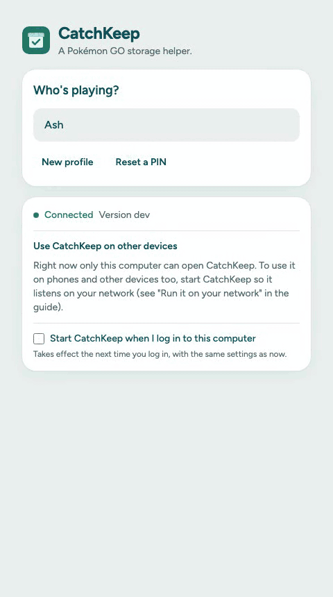
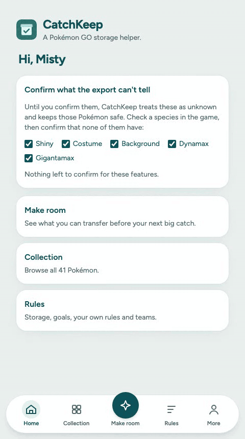
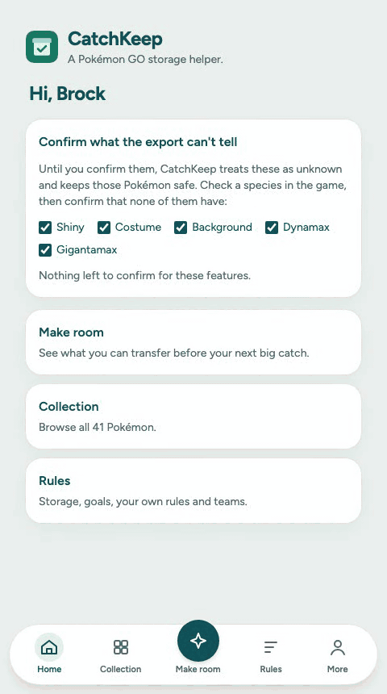

# CatchKeep

A Pokémon GO storage helper.

Storage is never quite big enough. You can have 4,000 slots and 2,500 Pokémon and still feel squeezed: a Community Day adds hundreds in an afternoon, and staying under 80% turns into a string of hard choices made in a hurry. Which of these 40 Pidgey matter? Is this my only shadow Machop? Did I already keep a good one?

Deciding what is worth keeping is only half of it. The hard part is knowing how much to clear, and when. Keep rules on their own never compare your total against the limit you want, and a heavy event week can fill the gap before you get round to cleaning up.

CatchKeep takes both off your plate. It reads your Poke Genie export, keeps the best copies of every variant by rules you set once, and shows what you can safely let go, so you go into the next Community Day with room to spare instead of clearing storage at the last minute.







## What you can do today

- **A profile per trainer.** Each trainer has a PIN-protected profile, so collections never get mixed up.
- **Import from Poke Genie.** See a preview first, then browse your collection strongest first, with each Pokémon's picture, CP, HP, IVs and level. Anything the export can't tell (shiny, costume, background, Dynamax) stays "unknown" instead of being assumed absent.
- **Re-import without duplicates.** Pokémon you already have are updated (new CP after a power-up, for example) instead of counted twice. Nothing is merged on its own: exact matches are confirmed in one tap, and anything less certain is shown side by side for you to decide.
- **Confirm what the export can't tell.** One species at a time: "None of my 34 Pidgey are shiny, costumed or have a background." Only unknowns change.
- **Storage and goals.** Say how many slots you have and what you keep Pokémon for (collecting, trading, battling), in order of priority. A preview shows what the defaults keep as you type.
- **Keep rules that scale with your storage.** The best copies of each variant are kept, more for bigger storage and more of legendary, mythical and Ultra Beast species. Lucky, shadow and purified copies count separately, and anything not yet confirmed is never counted as a transfer.
- **Possible transfers, species by species.** Tap a species to see every copy with its picture, marked keep or possible transfer, and why.
- **Your own rules.** Keep at least N of a species, or mark it a favorite to keep every copy. Set one rule for all legendary, mythical or Ultra Beast species at once; a species with its own rule follows that instead.
- **A rule inspector.** For each species: the default your storage sets, your own rules, protection, and the minimum that won.
- **Protection and teams.** Protect any single Pokémon and it is always kept, even over a stronger copy. Group Pokémon into named teams (a raid team, your buddies) and every member is always kept.

## Coming next

- **A headroom goal.** "Stay under 80% of storage" and "free 400 slots before Community Day", with a warning when you drift past it.
- **A cleanup plan.** How many to transfer to reach your goal, which ones, and in-game search strings to find them, with a checklist and undo.
- **History and insights.** Every addition and transfer is recorded, so you can see how fast storage fills, how much an event brings in, and which species you always end up transferring.

## Status

Early development. The plan is in [`spec/developer-spec.md`](spec/developer-spec.md).

## Development

Requires Node.js 24 (`.nvmrc`) and Go (version pinned in `backend/go.mod`).

```sh
npm install   # also installs git hooks
npm run check # formatting, markdown lint, shellcheck, OpenAPI lint
make -C backend check # gofmt/goimports, go vet, golangci-lint, go test -race
npm --prefix frontend install && npm --prefix frontend run check # tsc, oxlint, vitest
scripts/smoke.sh backend/bin/catchkeep frontend/dist # after building both: real binary + bundle
```

### Workflow

Ship each change with `scripts/ship.sh <branch> "<type(scope): subject>" "<PR description>"` after staging it. It refuses to start unless `main` is current and green, runs the local gates, opens the PR, waits for CI, squash-merges exactly the commit CI tested, and waits for `main` to be green again.

- Small, focused commits following [Conventional Commits](https://www.conventionalcommits.org/).
- All changes land on `main` through pull requests; `main` is protected.
- Quality gates run locally (pre-commit and commit-msg hooks) and in CI on every PR. A commit must pass them before the next one starts.
