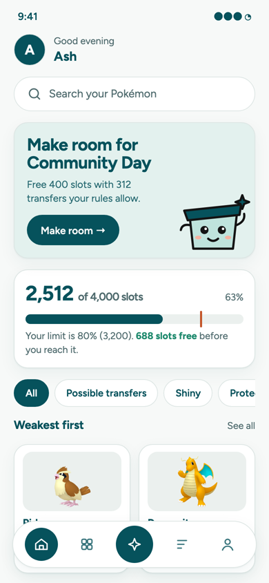
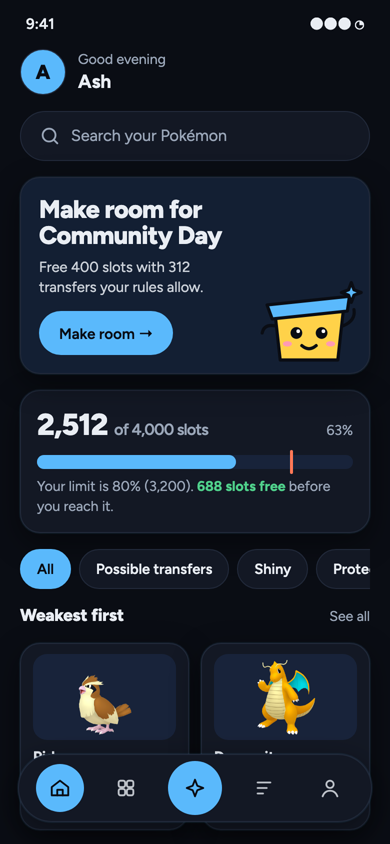

# Visual direction

Chosen in November 2026 from three mock-ups of the Home screen: **Teal on paper** by day, with the
**Night raid** colours when the device is in dark mode. Both modes share the same shapes, spacing and
typeface; only the colours change.

| Light                                                 | Dark                                                |
| ----------------------------------------------------- | --------------------------------------------------- |
|  |  |

These are mock-ups, not the app: the numbers are examples.

## Colour

| Token                           | Light (Teal on paper)       | Dark (Night raid)             |
| ------------------------------- | --------------------------- | ----------------------------- |
| Ground                          | `#f7f9f8`                   | `#0a0d14`                     |
| Surface (cards)                 | `#ffffff`                   | `#131824`                     |
| Soft surface (pictures, meters) | `#ebf0ee`                   | `#18233a`                     |
| Highlight card                  | `#e3f1ee`                   | `#131f33`                     |
| Text                            | `#06525c`                   | `#e9edf3`                     |
| Muted text                      | `#4f6b6e`                   | `#9aa6b8`                     |
| Accent (buttons, active tab)    | `#06525c` on `#ffffff` text | `#5ab9fc` with `#0a0d14` text |
| Lines                           | `#dce5e3`                   | `#222a3b`                     |
| Good (kept, free)               | `#1f8a6e`                   | `#4fd18b`                     |
| Warning (transfer, limit mark)  | `#c2562b`                   | `#ff7a59`                     |

The light palette is the taste skill's `teal-on-paper`; the dark one its `blue-black-cornflower`.

## Type

[Figtree](https://fonts.google.com/specimen/Figtree) in both modes: 400 for text, 600 for buttons and
labels, 700 to 800 for headings and big numbers. Sentence case.

## Shapes

- Rounded cards (20px corners) with a soft shadow in light mode and a faint outline in dark mode.
- Pill-shaped buttons, chips and search field.
- A floating, pill-shaped menu at the bottom on phones, with the middle button (Make room) raised in the
  accent colour; a top menu on wider screens.

## Keepy

The mascot is an original character: a friendly storage box with a lid, eyes, rosy cheeks and a small
star. Teal and mint in light mode, yellow and sky blue in dark mode. Our own illustrations never use
Pokémon artwork or look-alikes; Pokémon pictures are only loaded at runtime from the PokeAPI sprites.
